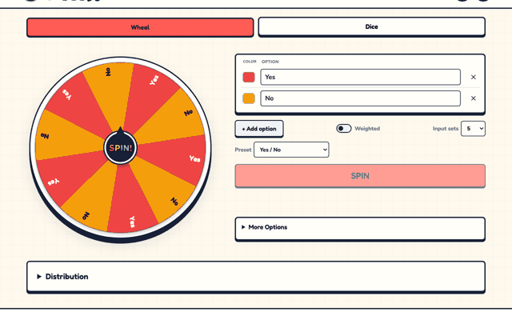
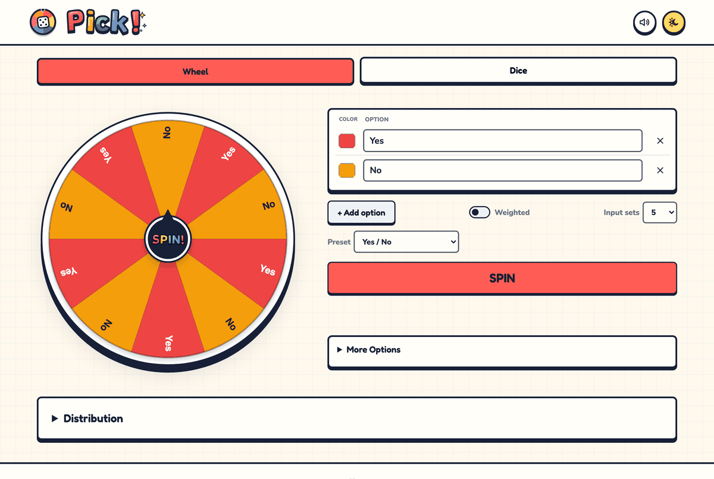
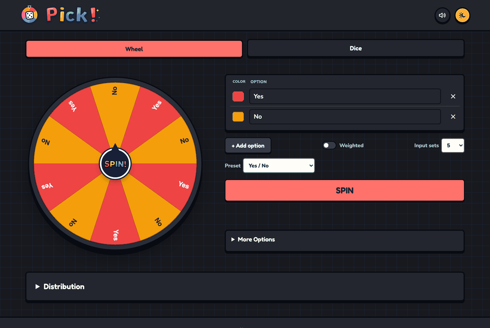
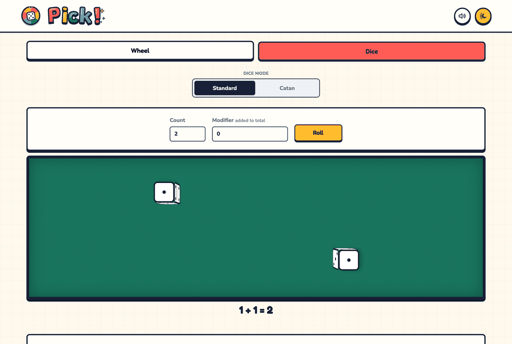
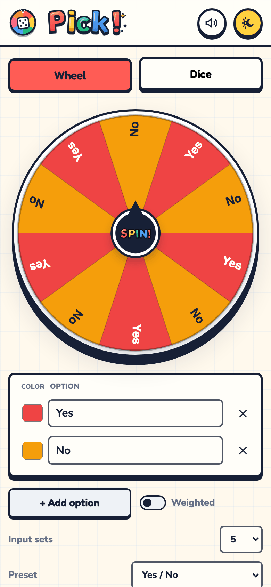

<div align="center">

# 🎡 Pick!

**Can't decide? Spin it.** A fluid yes/no wheel, a batch simulator, 3D dice and a Catan companion — all in your browser.

[](https://venkate5hgunda.github.io/pick/)




</div>

## ✨ Highlights

| | |
| --- | --- |
| 🎡 **Wheel** | Custom options, colors, optional weights, presets and a seven-second physics-based spin. |
| 📊 **Statistics** | Run 2–12 animated wheels or up to 10,000 instant spins and see the distribution. |
| 🎲 **Dice** | One to ten 3D dice on a felt table, plus a Catan mode with turn order and analytics. |
| 🌗 **Polished** | Light/dark themes, sound, haptics, WCAG AA contrast, reduced-motion support. |
| 🔒 **Private** | Static files only — no accounts, cookies, API keys or server state. |

<p align="center">
  
  
</p>

## 🚀 Quick start

```bash
python3 -m http.server 8080   # serve over HTTP (ES modules don't load from file://)
# open http://localhost:8080
npm test                      # unit tests, Node's built-in runner
```

## 📚 Documentation

| Topic | Page |
| --- | --- |
| Wheel options, weights, presets, spin and sound | [docs/wheel.md](docs/wheel.md) |
| Batch simulation and distribution charts | [docs/statistics.md](docs/statistics.md) |
| Dice and the Catan companion | [docs/dice-and-catan.md](docs/dice-and-catan.md) |
| Themes, accessibility and the easter egg | [docs/experience.md](docs/experience.md) |
| Local development and tests | [docs/development.md](docs/development.md) |
| Hosting on GitHub Pages | [docs/deployment.md](docs/deployment.md) |

<p align="center">
  
  
</p>

## 🗂️ Repository layout

```
index.html, css/, js/, assets/   the app (static, no build)
test/                            unit tests
docs/                            documentation and screenshots
```

## 📄 License

[MIT](LICENSE) © 2026 Venkatesh Gunda. Third-party code, assets and content remain subject to their own licenses.
