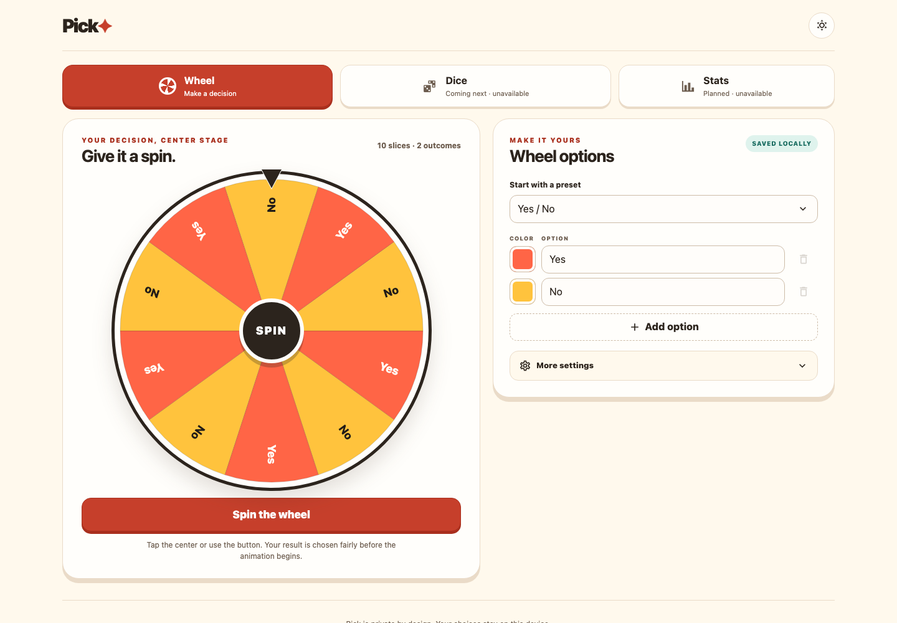
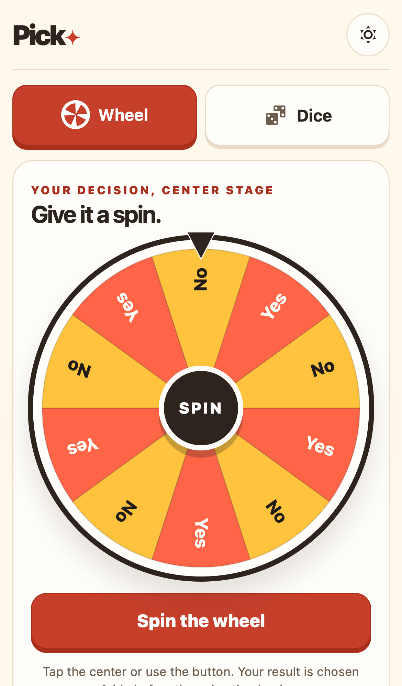

# Pick redesign

A new implementation of the existing product, grounded in its complete observable behavior.

**Milestone 2 in progress: first complete feature.** The redesign now opens on a responsive, interactive decision wheel with editable options, presets, visual repeats, optional integer weights, local save/resume and an accessible result dialog. The original application remains the behavior reference; the internal roadmap at `/#/roadmap` keeps the remaining feature groups explicit without appearing in the playable UI.

| Document | Purpose |
| --- | --- |
| [Requirements](requirements.md) | Feature groups, acceptance criteria and source/test evidence |
| [Architecture](architecture.md) | Target stack, ownership, state and rendering boundaries |
| [Migration and decisions](migration.md) | Data contracts, prior decisions, phases and rollout |
| [Verification](verification.md) | Checks performed, results and remaining release gates |
| [Parity inventory](parity.json) | Machine-readable requirements consumed by the foundation |
| [Source snapshot](source-snapshot.json) | SHA-256 file inventory at the baseline commit |

Baseline: [`76f540473de7`](https://github.com/venkate5hgunda/pick/commit/76f540473de7737badf6afb397b550b772578d96) from refreshed `origin/main`. Branch: `codex/redesign-foundation`. Stack: **Svelte + TypeScript + Vite**. Baseline evidence means inspected source and existing regression tests; it does not claim every existing game flow was manually revalidated during this milestone.

## Run the redesign

From the repository root, use Node 22.12+ (or a newer Vite-supported LTS):

```sh
npm --prefix redesign ci
npm --prefix redesign run dev
# http://127.0.0.1:5173
```

```sh
npm --prefix redesign test
npm --prefix redesign run build
npm --prefix redesign exec -- playwright install chromium webkit
npm --prefix redesign run test:browser
```

`npm --prefix redesign run capture` refreshes the documentation screenshots after a successful build.

Browser tests run the production build with Chromium desktop and WebKit mobile. The ports differ across the three repos, so all previews can run together. Dependencies, lockfile and build outputs are local to `redesign/`. Build/test output lives under its already-ignored `node_modules/.cache/`; no ignore-rule changes are required. Root commands continue to run the baseline app.

## Preview





The preview uses an isolated `pick:redesign:wheel-v1` local record and does not register a production service worker, account, notification subscription or remote API. The wheel is rendered locally at device resolution; icons ship in the bundle. P01 and P02 are implemented, not yet full parity-verified. The remaining groups stay planned and this is not a replacement release.
